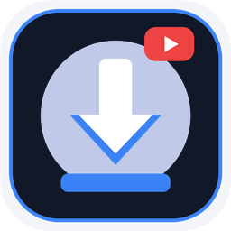

<div align="center">



# YDL Studio

**A portable Windows GUI for `yt-dlp` and `FFmpeg` with a streamlined paste-to-download workflow.**

[](https://github.com/hoperkim/ydl-studio/releases/latest)
[-Portable_.exe-0078D6?logo=windows&logoColor=white)](https://github.com/hoperkim/ydl-studio/releases/download/v2.0.0/YDL-Studio-v2.0.0.exe)
[](https://www.python.org/)
[](LICENSE)

[**English**](#-overview) · [**한국어 가이드 (Korean)**](#-한국어-가이드-korean) · [**Download Latest `.exe`**](https://github.com/hoperkim/ydl-studio/releases/latest) · [**Report an Issue**](https://github.com/hoperkim/ydl-studio/issues)

</div>

---

## 🎯 Overview

**YDL Studio** is an open-source Windows desktop application built with Python and CustomTkinter that wraps [`yt-dlp`](https://github.com/yt-dlp/yt-dlp) and [`FFmpeg`](https://ffmpeg.org/) into a single, easy-to-use visual interface.

- **Who it is for**: Windows users who want the extraction capabilities of `yt-dlp` and `FFmpeg` without memorizing command-line flags, managing Python environments, or clicking through multi-step confirmation dialogs for every link.
- **Key differentiator**: **Paste-to-Download (Zero-Click Queueing)**. Paste one or more URLs (`Ctrl+V` or the one-click paste button), and YDL Studio asynchronously inspects the link, selects an appropriate video (`MP4`) or audio (`MP3 320kbps` / `FLAC`) preset based on your top-bar mode, and starts downloading immediately.

---

## 📥 Download (Windows 10 / 11 64-bit)

No Python installation is required for the standalone executable.

- **Direct Download (`v2.0.0`)**: [**`YDL-Studio-v2.0.0.exe`**](https://github.com/hoperkim/ydl-studio/releases/download/v2.0.0/YDL-Studio-v2.0.0.exe)
- **Releases Page**: [github.com/hoperkim/ydl-studio/releases/latest](https://github.com/hoperkim/ydl-studio/releases/latest)

### Binary Checksum (`SHA-256`)

Verify your downloaded binary in PowerShell with `Get-FileHash .\YDL-Studio-v2.0.0.exe -Algorithm SHA256`:

```text
058E4DD82A02FAB60A5FF828541D4120F89619384B71605E9A8723B545044526
```

> [!NOTE]
> **First-Run FFmpeg Bootstrap**: High-resolution video merging (1080p/4K DASH) and audio conversion (`MP3`/`FLAC`) require `ffmpeg.exe`. If `ffmpeg.exe` is not already installed on your system `PATH` or next to the executable, YDL Studio automatically downloads a static Windows build into `%LOCALAPPDATA%\YDLStudio\bin` on first launch.

---

## 🚀 3-Step Quick Start

1. **Run `YDL-Studio-v2.0.0.exe`** (if Windows SmartScreen prompts on first run, click **More info** → **Run anyway**; see [Security & SmartScreen](#-privacy-cookies-security--responsible-use)).
2. **Choose your Mode** in the top bar (default: `🤖 스마트 자동` / Smart Auto, which picks `MP4` for video links and `MP3 320kbps` for music/audio links).
3. **Press `Ctrl+V` or click `[📋 원클릭 복붙]` (One-Click Paste)** after copying a media URL. The link is analyzed in the background and added directly to the active download queue.

---

## ✨ Key Features (Verified in Source)

| Feature | Implementation Evidence | Status |
| :--- | :--- | :--- |
| **Paste-to-Download Workflow** | [`app/ui/main_window.py`](app/ui/main_window.py), [`app/ui/components/url_input_bar.py`](app/ui/components/url_input_bar.py) | Stable |
| **Smart Video/Audio Intent Detection** | Classifies URLs by domain and file extension (`music.youtube.com`, `soundcloud.com`, `.mp3`, `.flac`, etc.) in [`app/utils/clipboard.py`](app/utils/clipboard.py) | Stable |
| **YouTube Mix / Radio URL Sanitizer** | Automatically strips `list=RD...` and `start_radio=1` from single-video watch URLs so unwanted 50-video radio queues are not triggered ([`clean_media_url`](app/utils/clipboard.py)) | Stable |
| **Multi-URL Batch Paste** | Extracts and deduplicates multiple space- or newline-separated URLs from a single clipboard paste ([`extract_all_urls`](app/utils/clipboard.py)) | Stable |
| **Multi-Fragment Parallel Downloading** | Configures `yt-dlp` with `concurrent_fragment_downloads = 8` for segmented HLS/DASH streams ([`app/core/downloader.py`](app/core/downloader.py)) | Stable |
| **Browser Cookie Retry Fallback** | Optional cookie loading from Chrome, Edge, Whale, Brave, or Firefox (`cookiesfrombrowser`). Automatically retries without cookies if the browser's SQLite cookie DB is locked ([`app/core/downloader.py`](app/core/downloader.py)) | Stable |
| **Multi-Stage Stream Fallback Pipeline** | Falls back from `yt-dlp` → HTML/iframe/packed-JS scan ([`app/core/deep_scanner.py`](app/core/deep_scanner.py)) → direct `FFmpeg` remux → Chrome/Edge CDP browser session ([`app/core/browser_fetcher.py`](app/core/browser_fetcher.py)) | Best-Effort |
| **Music Metadata Search Bridge** | Reads public OpenGraph `<meta>` track titles from Spotify/Melon/Genie/Bugs/Apple Music links and searches YouTube for matching audio (`ytsearch1:...`) in [`app/core/metadata.py`](app/core/metadata.py) | Experimental |

---

## 🌐 Supported Sites, Formats & Known Limitations

### Supported Formats
- **Video Presets**: Best Auto (`MP4` merged via `FFmpeg`), `4K (2160p MP4)`, `2K (1440p MP4)`, `1080p FHD MP4`, `720p HD MP4`, `480p MP4`.
- **Audio Presets**: `MP3 (320kbps)` with embedded thumbnail and metadata tags, `FLAC` (lossless container conversion), `M4A (AAC)`, `MP3 (192kbps)`.

### Supported Platforms & Real-World Boundaries

| Category | Examples | How It Works & Limitations |
| :--- | :--- | :--- |
| **Standard `yt-dlp` Sites** | YouTube, YouTube Music, SoundCloud, Bandcamp, TikTok, Instagram, X (Twitter), Twitch, Reddit, Vimeo, Bilibili, Chzzk, SOOP | Handled natively by `yt-dlp`. Age-restricted or member-only posts require logging in with a supported browser and enabling browser cookies in **Settings (`⚙️`)**. |
| **Direct & Embedded Web Streams** | Direct `.m3u8` (HLS), `.mpd` (DASH), `.mp4`, `.mp3`, and pages using `eval(function(p,a,c,k,e,d))` packed JS players | Scanned via [`app/core/deep_scanner.py`](app/core/deep_scanner.py) or captured via the local Chrome/Edge CDP helper ([`app/core/browser_fetcher.py`](app/core/browser_fetcher.py)). Requires Microsoft Edge or Google Chrome installed locally for Stage 4 browser fallback. |
| **Music Chart / Streaming Links** *(Experimental Bridge)* | Spotify, Melon, Genie, Bugs, Apple Music, FLO, VIBE track URLs | **Does NOT decrypt or rip streams directly from DRM music servers.** YDL Studio reads the public OpenGraph title/artist from the shared link and queries YouTube (`ytsearch1:<artist - title> official audio`). Results depend on public metadata visibility and YouTube match accuracy. |
| **Hardware DRM & External Cast Sessions** *(Unsupported)* | Netflix, Disney+, Amazon Prime Video, Widevine/PlayReady/FairPlay EME streams, hardware-isolated Chromecast receiver streams | **Not supported.** YDL Studio does not circumvent Widevine/PlayReady DRM and cannot intercept media streams that are fetched directly by an external TV/Chromecast device rather than the local PC browser. |

---

## 🛠️ Troubleshooting & FAQ

<details>
<summary><strong>1. Chrome/Edge cookie error: "Could not copy Chrome cookie database"</strong></summary>

Chromium-based browsers lock their SQLite cookie file while running on Windows.
- **Automatic behavior**: YDL Studio automatically retries the download without cookies if the database is locked.
- **If the video requires login/age verification**: Either close all Chrome/Edge windows before downloading, or use **Firefox** for authenticated cookies in `⚙️ Settings`.
</details>

<details>
<summary><strong>2. Audio conversion (MP3/FLAC) or 1080p+ video merge fails</strong></summary>

Check the top-right status indicator for `FFmpeg Ready`.
- If `FFmpeg` was blocked by a firewall during first-run bootstrap, download a Windows build from [ffmpeg.org](https://ffmpeg.org/download.html) or [gyan.dev](https://www.gyan.dev/ffmpeg/builds/) and place `ffmpeg.exe` and `ffprobe.exe` in the same folder as `YDL-Studio-v2.0.0.exe` or in `%LOCALAPPDATA%\YDLStudio\bin`.
</details>

<details>
<summary><strong>3. Stage 4 Browser Fallback / Live Stream Sniffer does not launch</strong></summary>

The browser-context downloader ([`app/core/browser_fetcher.py`](app/core/browser_fetcher.py)) and interactive sniffer ([`app/core/browser_sniffer.py`](app/core/browser_sniffer.py)) require a local installation of **Google Chrome** or **Microsoft Edge** (standard on Windows 10/11) to open a temporary Chrome DevTools Protocol (CDP) session.
</details>

<details>
<summary><strong>4. A site that worked yesterday stopped working</strong></summary>

Streaming platforms frequently change their player scripts. When running from source, update `yt-dlp` with:
```powershell
pip install -U yt-dlp
```
For standalone `.exe` users, check the [Releases](https://github.com/hoperkim/ydl-studio/releases) page or open an issue with the failing URL pattern.
</details>

---

## 🔒 Privacy, Cookies, Security & Responsible Use

- **No Telemetry or External Servers**: YDL Studio runs entirely on your local PC. It only makes network requests to the media URLs you provide (and to GitHub on first launch if `ffmpeg.exe` needs to be downloaded).
- **Local-Only Browser Cookies**: Cookie extraction is **disabled by default** (`안 함 (기본)`). When enabled in Settings, cookies are read locally by `yt-dlp` or via an isolated temporary profile in `%LOCALAPPDATA%\Temp\YDLStudio_ChromeProfile` and are never uploaded anywhere.
- **Windows Defender SmartScreen Notice**: Because `YDL-Studio-v2.0.0.exe` is built with PyInstaller and is not signed with a paid Extended Validation (EV) code-signing certificate, Windows SmartScreen may display *"Windows protected your PC"* on first launch. You can verify the [`SHA-256` checksum](#binary-checksum-sha-256) above or run the application directly from Python source code.
- **Responsible Use**: This tool is intended for downloading user-owned content, Creative Commons/public-domain media, or content explicitly permitted by the hosting platform. Users are solely responsible for complying with applicable copyright laws and website Terms of Service.

---

## 🧑‍💻 Developer Setup, Testing & Build Instructions

### Prerequisites
- Windows 10 / 11 (64-bit)
- Python 3.10 or newer
- `ffmpeg` (optional if testing auto-bootstrap)

### Run from Source

```powershell
git clone https://github.com/hoperkim/ydl-studio.git
cd ydl-studio

python -m venv .venv
.\.venv\Scripts\activate
pip install -r requirements.txt

python main.py
```

### Run Automated Unit Tests

```powershell
python -m unittest discover -s tests -v
```

### Build Standalone `.exe`

```powershell
pip install pyinstaller
pyinstaller "YDL Studio.spec" --noconfirm
```
The compiled executable will be generated at `dist\YDL Studio.exe`.

---

## 🇰🇷 한국어 가이드 (Korean)

**YDL Studio**는 복잡한 명령어 없이 `yt-dlp`와 `FFmpeg`를 윈도우 그래픽 환경(GUI)에서 간편하게 사용할 수 있도록 만든 오픈소스 포터블 미디어 다운로더입니다.

### 1. 다운로드 및 바로 실행 (설치 불필요)
- **최신 포터블 실행 파일**: [**`YDL-Studio-v2.0.0.exe` 다운로드**](https://github.com/hoperkim/ydl-studio/releases/download/v2.0.0/YDL-Studio-v2.0.0.exe)
- 별도의 설치 과정이나 파이썬 설치 없이 다운로드한 `.exe` 파일을 바로 실행하면 됩니다.
- 첫 실행 시 고화질 영상 병합 및 음원 변환에 필요한 `ffmpeg.exe`가 시스템에 없으면 `%LOCALAPPDATA%\YDLStudio\bin` 경로에 자동으로 준비됩니다.

### 2. 3단계 사용법
1. 프로그램 상단에서 **작업 모드**를 선택합니다 (기본값: `🤖 스마트 자동` — 일반 영상 링크는 `MP4`, 음원/뮤직 링크는 `MP3 320kbps`로 자동 분류).
2. 다운로드할 영상이나 음원 주소를 복사한 뒤 **`Ctrl+V`** 또는 **`[📋 원클릭 복붙]`** 버튼을 누릅니다.
3. 백그라운드에서 링크 분석 후 별도의 추가 클릭 없이 **즉시 다운로드 큐에 등록되어 진행**됩니다. 완료 후 카드 우측의 **`[▶️ 바로 재생]`** 또는 **`[📂 폴더]`** 버튼으로 결과를 바로 확인할 수 있습니다.

### 3. 주요 기능 및 동작 한계 (투명한 안내)
- **유튜브 믹스(Mix/Radio) 자동 정제**: `watch?v=...&list=RD...` 형태의 링크를 붙여넣을 때 의도치 않게 50곡 재생목록 전체가 걸리는 현상을 방지하고 현재 영상만 추출합니다.
- **다단계 스트림 탐색 파이프라인**: 기본 `yt-dlp` 추출이 실패할 경우 웹페이지 내 HTML/iframe/난독화 스크립트(`DeepWebScanner`) 및 로컬 Chrome/Edge 브라우저 세션(`BrowserStreamDownloader`)을 순차적으로 시도합니다.
- **음원 차트 링크 브릿지 (실험적 기능)**: 멜론, 스포티파이, 지니, 벅스, 애플뮤직 등의 곡 공유 링크는 해당 서비스의 DRM을 직접 해독하는 것이 아니라, 페이지의 공개 OpenGraph 곡명·아티스트 정보를 읽어 유튜브 공식 음원(`ytsearch1`)을 매칭해 추출합니다. 따라서 페이지 메타데이터가 비공개이거나 유튜브에 동일 음원이 없는 경우 다른 버전이 매칭되거나 실패할 수 있습니다.
- **지원 제외 대상**: 넷플릭스, 디즈니+ 등 상용 DRM(Widevine/PlayReady)이 적용된 OTT 영상이나 로컬 브라우저를 거치지 않는 외부 하드웨어 캐스트(Chromecast 등) 스트림은 지원하지 않습니다.

---

## 🤝 Contributing, License & Acknowledgements

- **Contributing**: Bug reports, site-specific extraction fixes, and pull requests are welcome. Please read [CONTRIBUTING.md](CONTRIBUTING.md) before submitting changes.
- **License**: Distributed under the [MIT License](LICENSE).
- **Acknowledgements**:
  - [yt-dlp](https://github.com/yt-dlp/yt-dlp) for the core media extraction engine.
  - [FFmpeg](https://ffmpeg.org/) for stream remuxing and audio transcoding.
  - [CustomTkinter](https://github.com/TomSchimansky/CustomTkinter) for modern Tkinter UI components.
